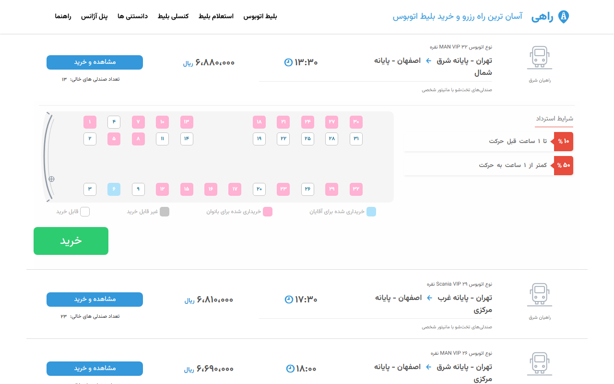
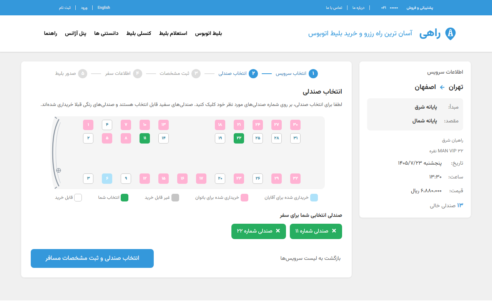
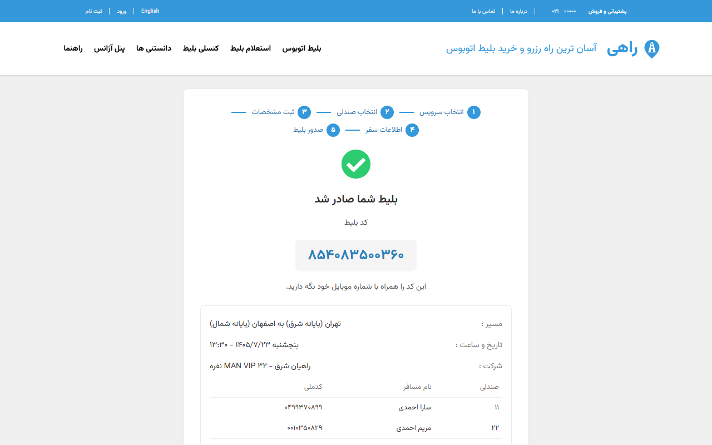
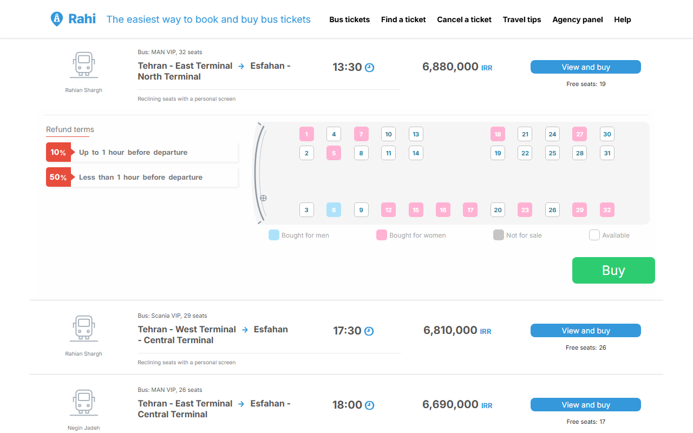
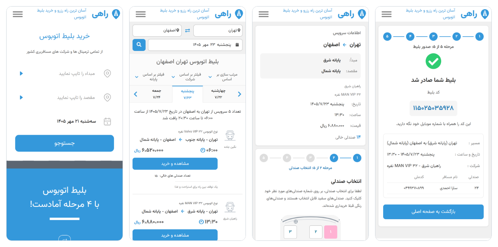

<div dir="rtl">

# راهی — سامانه رزرو بلیط اتوبوس

[English](README.md) | **فارسی**

[](https://github.com/ali-padash/bus-ticket-reservation-system/actions/workflows/ci.yml)

راهی یک وب‌سایت خرید بلیط اتوبوس است که یک API نوشته‌شده با Go پشت آن قرار دارد: جست‌وجوی سفر،
انتخاب صندلی از روی نقشه اتوبوس، وارد کردن مشخصات مسافران و دریافت بلیط. سایت دو زبان دارد:
انگلیسی (چپ به راست، در نشانی `/en/`) و فارسی (راست به چپ، در نشانی `/fa/`).

این یک پروژه تمرینی است. ظاهر و مراحل آن از روی سایت ایرانی **سفر۷۲۴** الگوبرداری شده است.
راهی هیچ ارتباطی با سفر۷۲۴ ندارد، چیزی نمی‌فروشد و صفحه پرداخت آن آزمایشی است. نام، نشان و
تصویرها متعلق به خود پروژه‌اند و فونت‌ها و آیکون‌ها رایگان هستند. نسخه اول در سال ۲۰۲۴ نوشته شد
و در سال ۲۰۲۶ بازنویسی شد؛ نسخه اصلی با برچسب `v1-original` در گیت نگه داشته شده است.

## دمو

## تصویرها

| نتیجه جست‌وجو، با یک سفر بازشده | انتخاب صندلی |
| --- | --- |
|  |  |

| بلیط صادرشده | همین سایت به انگلیسی، چپ به راست |
| --- | --- |
|  |  |

روی گوشی:



## چه کارهایی می‌کند

- **جست‌وجو** بر اساس شهر مبدأ، شهر مقصد و تاریخ. جست‌وجو در نشانی صفحه نگه داشته می‌شود؛
  برای همین با لینک، تازه‌سازی صفحه و دکمه بازگشت همان جست‌وجو تکرار می‌شود. نتیجه‌ها را می‌توان
  مرتب و فیلتر کرد.
- **کادرهای شهر با تکمیل خودکار** از میان ۹۱۵ شهر و املاهای مختلف آن‌ها.
- **نقشه صندلی** که از روی چیدمان ذخیره‌شده در پایگاه داده رسم می‌شود؛ برای هر نوع اتوبوس یک چیدمان.
- **خرید بدون حساب کاربری**: انتخاب تا ۴ صندلی، وارد کردن یک مسافر برای هر صندلی، مرور،
  پرداخت در صفحه بانک آزمایشی و دیدن بلیط صادرشده.
- **صندلی‌ها ۱۰ دقیقه نگه داشته می‌شوند** تا خریدار مرور و پرداخت کند، و اگر پرداخت نکند آزاد می‌شوند.
- **بلیط با کد ۱۲ رقمی و شماره موبایل خریدار باز می‌شود**، در صفحه «استعلام بلیط».
- **مناسب گوشی.** همه صفحه‌ها در عرض ۳۶۰، ۳۹۰ و ۴۸۰ پیکسل و در هر دو زبان بررسی شده‌اند.
- **دو زبان.** زبان، بخش اول نشانی صفحه است؛ پس لینک آن را حفظ می‌کند. جهت چیدمان، رقم‌ها،
  تقویم (میلادی یا شمسی) و فونت از زبان پیروی می‌کنند.

## بخشی که ارزش خواندن دارد: دو نفر، یک صندلی

دو خریدار هرگز نباید یک صندلی را بگیرند. سه چیز این را تضمین می‌کند:

1. هر رزرو در یک تراکنش پایگاه داده اجرا می‌شود که ردیف صندلی‌های انتخاب‌شده را قفل می‌کند
   (`SELECT ... FOR UPDATE`)، همیشه به ترتیب شماره صندلی، تا دو رزرو هم‌پوشان به بن‌بست (deadlock) نرسند.
2. درون همان قفل بررسی می‌شود که صندلی‌ها هنوز آزاد باشند.
3. یک ایندکس یکتای جزئی روی جدول مسافران فقط یک مسافر فعال برای هر صندلی را می‌پذیرد؛ پس
   حتی اگر کد اشتباه باشد، خود پایگاه داده فروش دوباره را رد می‌کند.

دو تست این را روی یک PostgreSQL واقعی ثابت می‌کنند: ۲۰ خریدار در یک لحظه یک صندلی را می‌خواهند
و دقیقاً یک نفر آن را می‌گیرد؛ ۲۴ خریدار با انتخاب‌های هم‌پوشان همگی بدون بن‌بست به پایان می‌رسند.

## چگونه ساخته شده است

| بخش | فناوری |
| --- | --- |
| API (`backend/`) | Go 1.22، Gin، GORM، PostgreSQL 17، مهاجرت‌های SQL با goose |
| وب‌سایت (`devs/`) | React 18، TypeScript، Vite، React Router، i18next، CSS دست‌نویس |
| پایگاه داده محلی | Docker Compose |

API سه لایه دارد و هر لایه فقط لایه زیر خود را می‌شناسد:

</div>

```
backend/
├── cmd/api/            starts the server; also the "migrate" and "seed" commands
├── internal/
│   ├── httpapi/        reads requests, writes JSON, maps errors to status codes
│   ├── service/        the rules: validation, the 10-minute hold, the city cache
│   ├── store/          the SQL
│   ├── domain/         the plain types and named errors the layers share
│   ├── config/         settings from the environment
│   └── seed/           demo data
└── migrations/         the database schema, as numbered SQL files

devs/src/
├── pages/              one file per page
├── components/         the pieces the pages are made of
├── util/               API calls, types, validation, date and language helpers
├── locales/            every text of the site, one file per language
└── assets/             CSS, fonts, images
```

<div dir="rtl">

هر پوشه یک فایل `[foldername].doc.md` دارد که آن را توضیح می‌دهد (به انگلیسی). از
[Safar724.doc.md](Safar724.doc.md) شروع کنید. مسیرها، فیلدها و کدهای خطای API در
[backend/internal/httpapi/httpapi.doc.md](backend/internal/httpapi/httpapi.doc.md) نوشته شده‌اند.

## اجرا

به Docker، Go نسخه 1.22 یا جدیدتر و Node.js نسخه 18 یا جدیدتر نیاز دارید.

</div>

```bash
cp .env.example .env
docker compose up -d db
cd backend
go run ./cmd/api seed
go run ./cmd/api
```

<div dir="rtl">

دستور `seed` جدول‌ها را می‌سازد و با داده نمونه پر می‌کند و هرچه از قبل بوده پاک می‌شود. پس از آن
API روی `http://localhost:8080` گوش می‌دهد.

در یک ترمینال دیگر:

</div>

```bash
cd devs
npm install
npm run dev
```

<div dir="rtl">

نشانی `http://localhost:5173` را باز کنید. سفرهای نمونه میان تهران، مشهد، اصفهان، شیراز، تبریز،
رشت، اهواز و یزد برقرارند، برای ۱۴ روز از روزی که `seed` اجرا شده است.

اگر پورتی اشغال بود، `API_ADDR` و `CORS_ORIGIN` را در `.env` تنظیم کنید (فایل `.env.example` را
ببینید)، Vite را با `npm run dev -- --port <port>` اجرا کنید و نشانی API را در `devs/.env.local`
به شکل `VITE_API_URL=http://localhost:<port>` بنویسید.

## بررسی‌ها

</div>

```bash
cd backend
go vet ./...
go test ./...
```

<div dir="rtl">

۶۶ تست. ۲۱ تا از آن‌ها از پایگاه داده استفاده می‌کنند و وقتی پایگاه داده در حال اجرا نباشد رد می‌شوند (skip).

</div>

```bash
cd devs
npx tsc --noEmit
npm run lint
npm run build
```

<div dir="rtl">

GitHub Actions همه این‌ها را با هر push، روی یک PostgreSQL واقعی اجرا می‌کند
([.github/workflows/ci.yml](.github/workflows/ci.yml) را ببینید).

## محدودیت‌ها

- ورود، حساب کاربری و پنل شرکت‌های مسافربری وجود ندارد. سفرها فقط از داده نمونه می‌آیند.
- پرداخت یک صفحه آزمایشی است. هیچ پولی جابه‌جا نمی‌شود.
- بلیط پرداخت‌شده هنوز قابل لغو نیست. شرایط استرداد نمایش داده می‌شود اما اعمال نمی‌شود.
- برای تعداد صندلی‌هایی که یک بازدیدکننده می‌تواند نگه دارد سقفی وجود ندارد.
- وب‌سایت تست خودکار ندارد.
- پروژه روی اینترنت مستقر نشده است.
- از لینک‌های منو فقط «بلیط اتوبوس» و «استعلام بلیط» به جایی می‌رسند.
- فایل `Safar724.drawio.png` طراحی پایگاه داده سال ۲۰۲۴ را نشان می‌دهد، نه طراحی فعلی را.
- در کامیت‌های قدیمی رمز دو پایگاه داده میزبانی‌شده وجود دارد. هر دو پایگاه داده حذف شده‌اند.

</div>
